# Code Examples

A collection of code samples from various projects. This repository serves as a reference for different programming concepts, best practices, and solutions implemented across various projects.

## Neos  
[Neos – A New Chapter for Future-Oriented City Cleaning](https://www.remondis-digital.com/news/detail/neos-neues-kapitel-fuer-die-zukunftsorientierte-stadtreinigung/)  
 
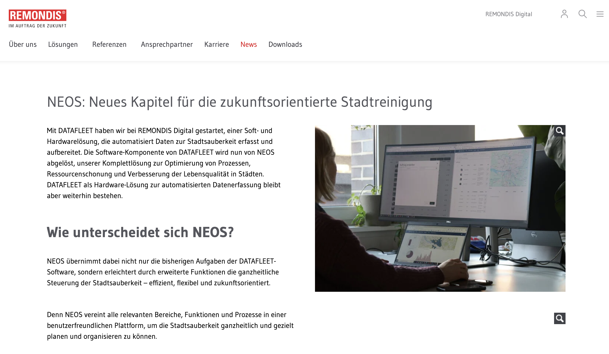
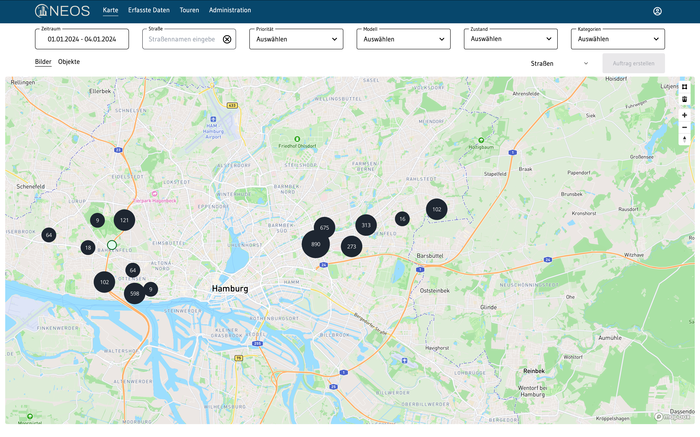
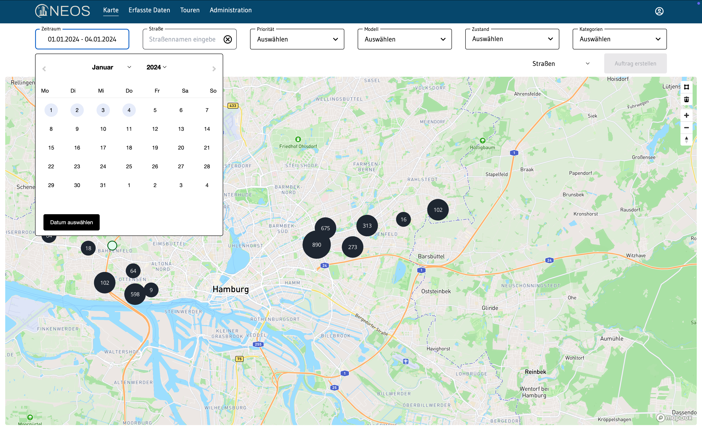
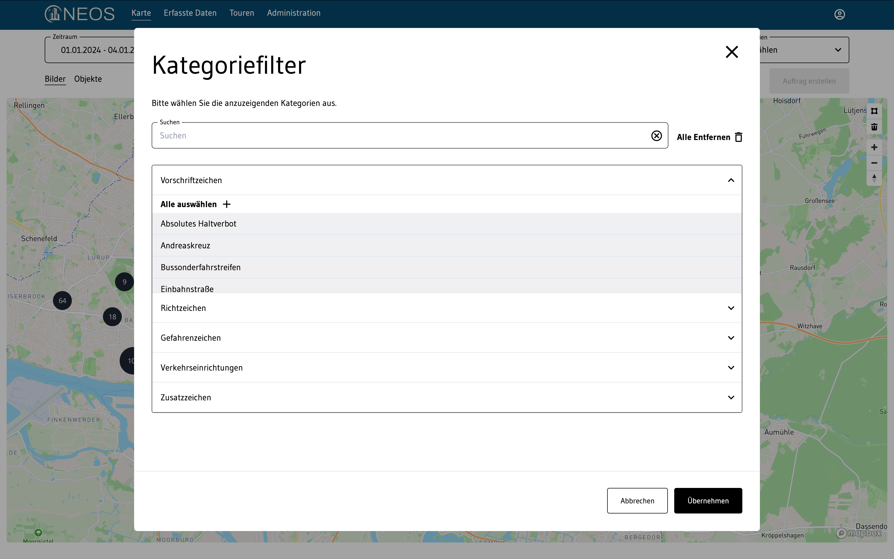
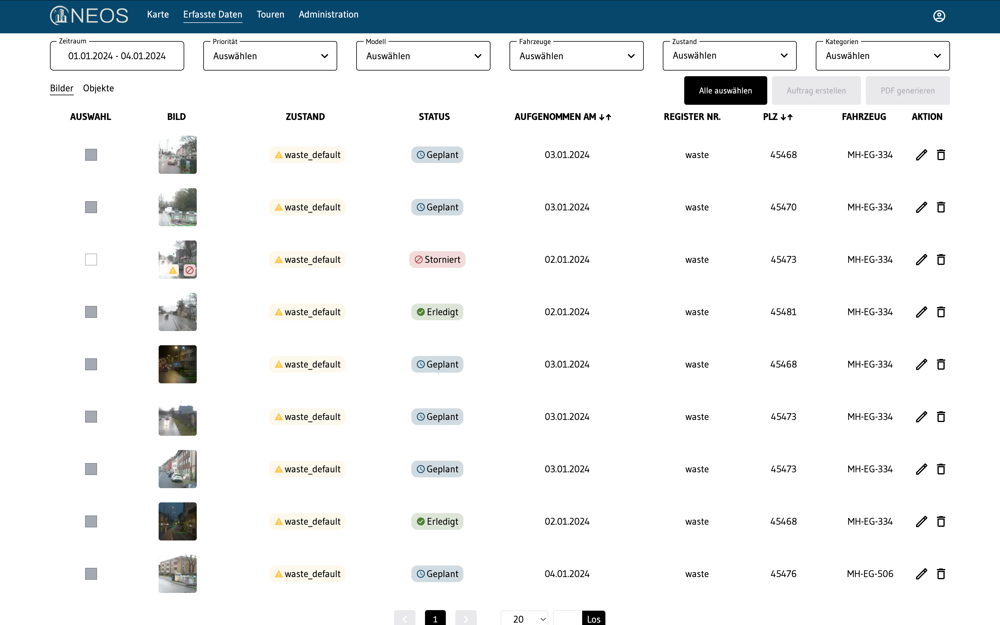
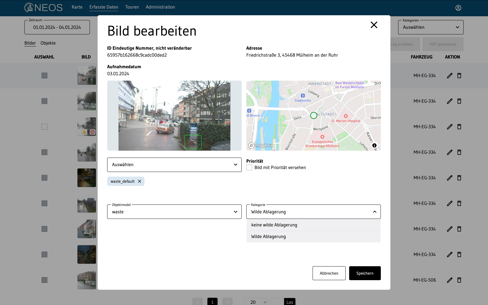

## Remondis UI Lib  
[Remondis UI – A custom component library built with vite and storyboook](https://test-lib-ten.vercel.app/)  
 
## Leica Q  
[Campaign with Virtue Worldwide - Preview:](https://ericcortes.de/leica/)  
 
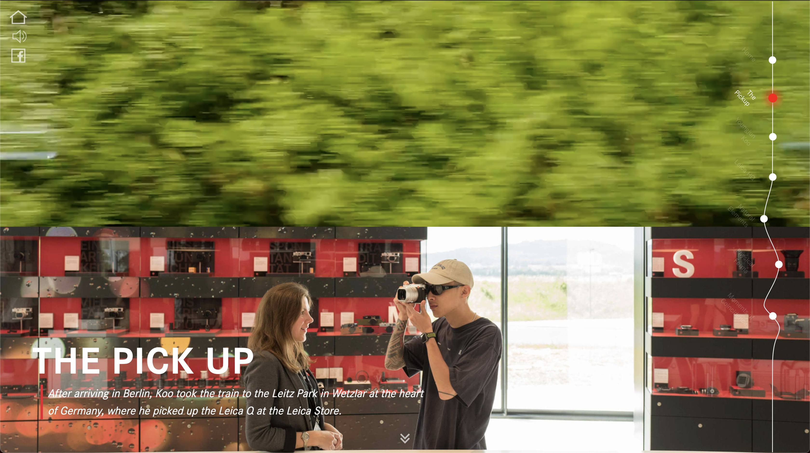
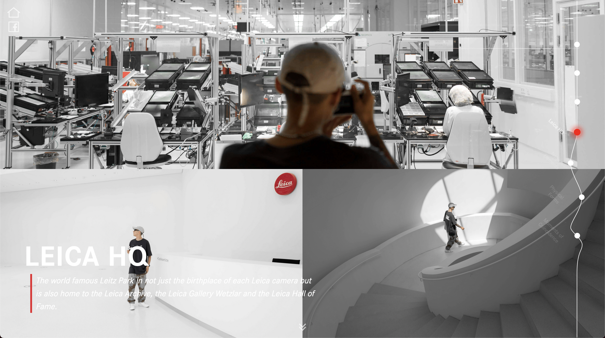
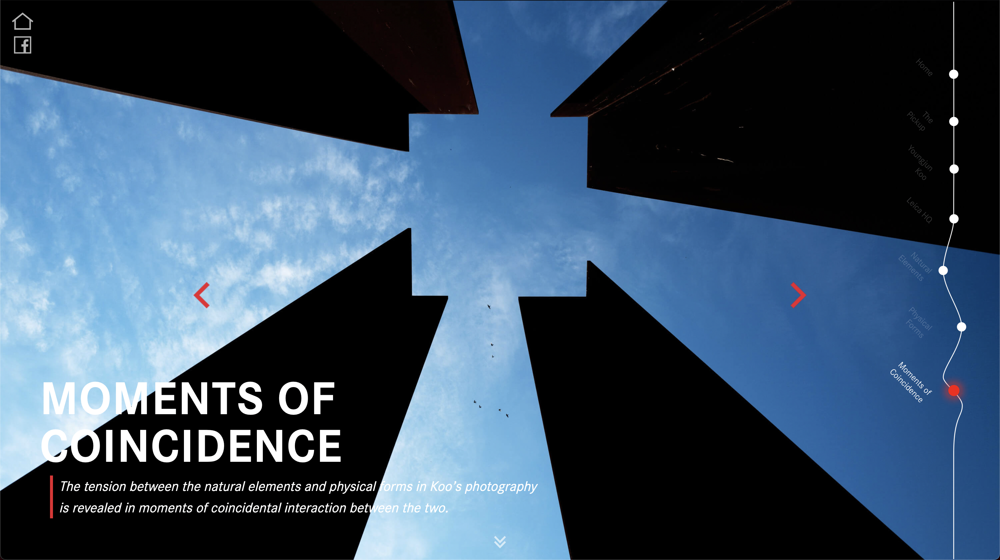

## Binity  
[Binity – A driver App](https://binity-test.vercel.app/routes)  

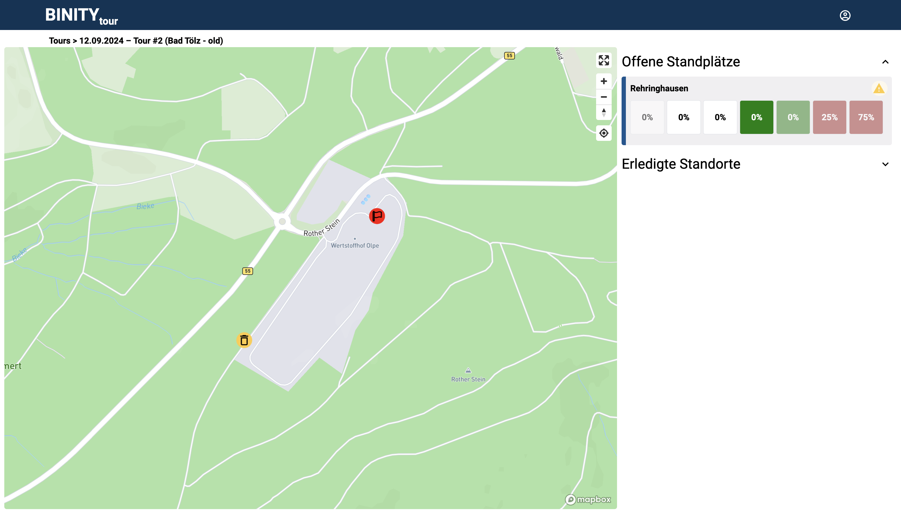
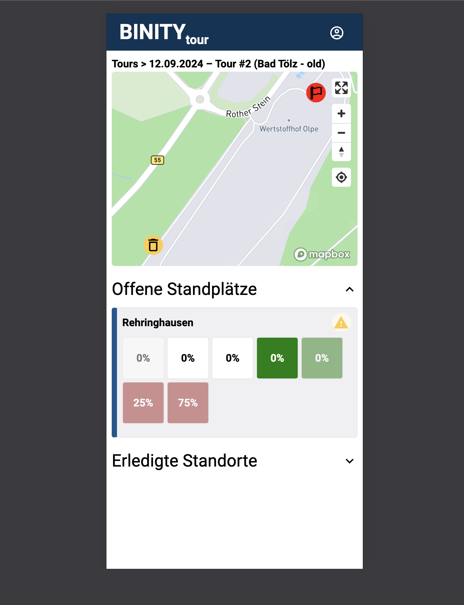
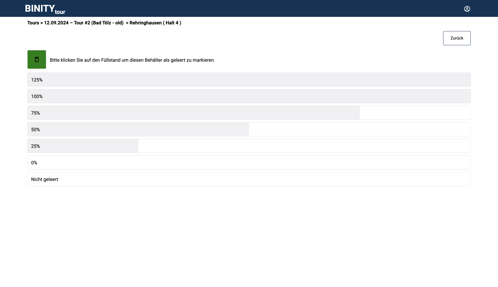

## Repository Structure

The repository contains examples covering different topics, including:  
- **Frontend Development** (Nextjs, React, HTML, CSS, JavaScript, etc.)  
- **Data Structures & Algorithms**  
- **Automation Scripts**  
